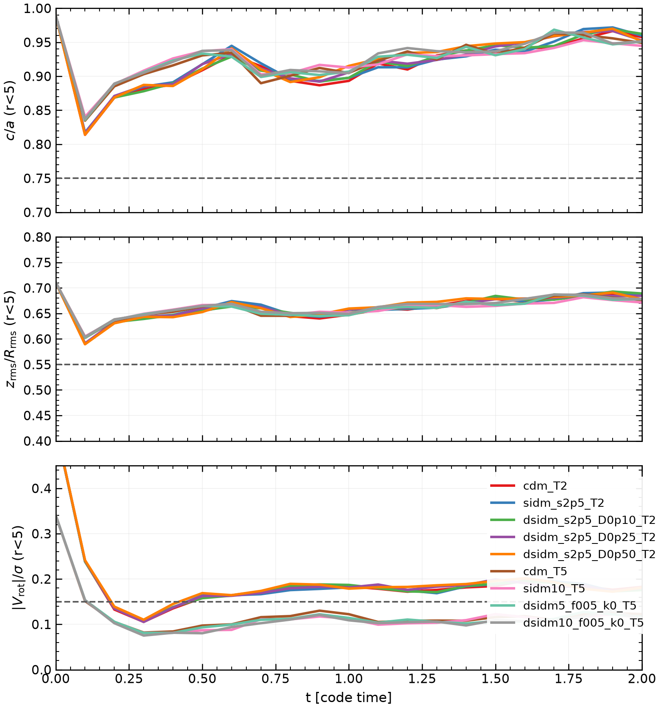
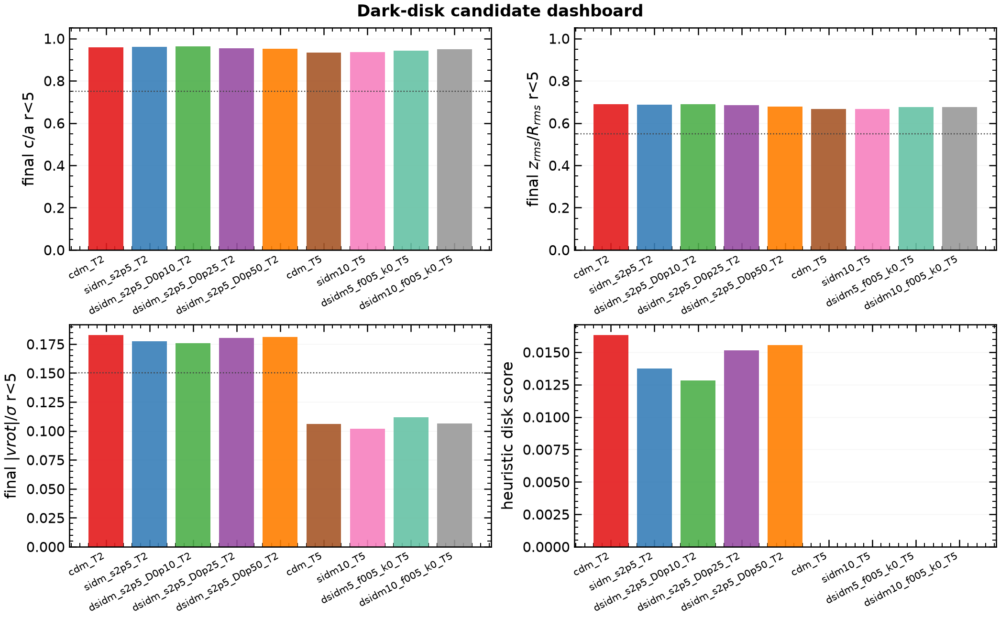
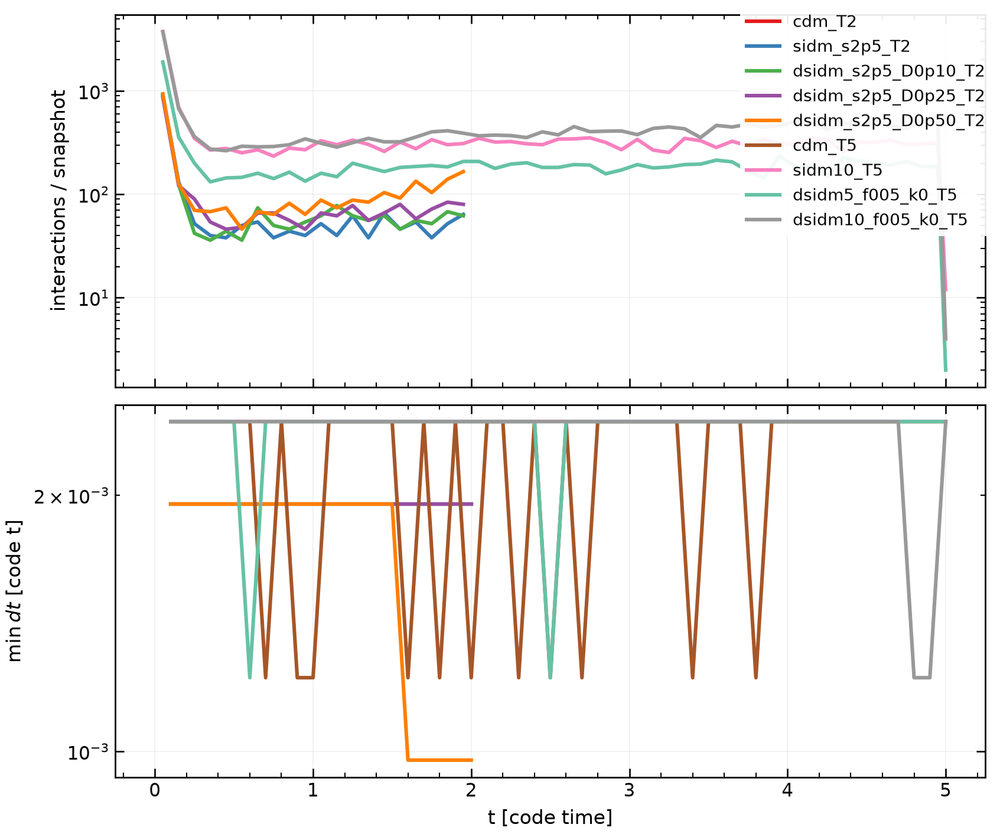
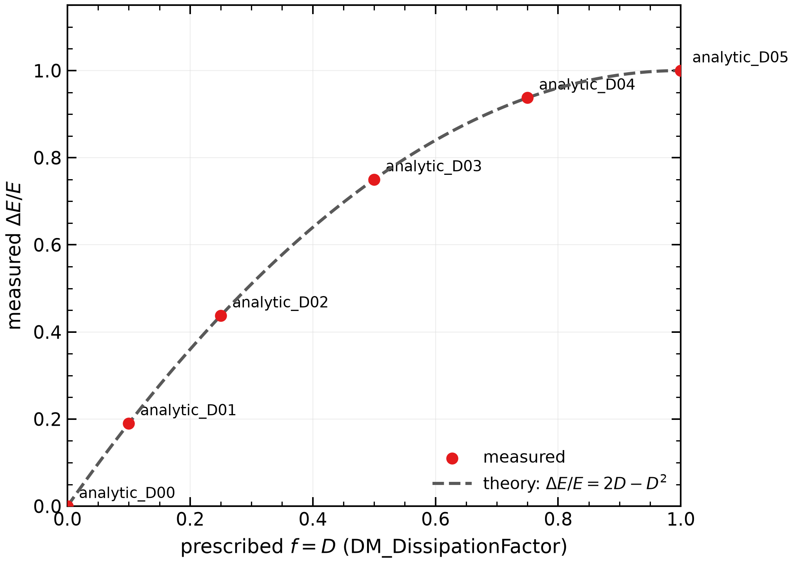

# dSIDM и вращающаяся структура

**M7 editable slide source · `science_partial`**
`visual_review_pending` · `rehearsal_pending` · M5 не одобрен/не завершён

11 основных слайдов + backup. Числа и статусы ниже имеют explicit relative locator;
старые PNG не считаются новым evidence. Заметки и timing: [speaker_notes.md](speaker_notes.md).

## S01 — Вопрос и область вывода (0:45)

**M7-C01 · pending.** Может ли dSIDM в ограниченной серии изолированных вращающихся
NFW-гало дать устойчивую тонкую структуру до численной патологии? Это ограниченный
эксперимент (`N=10^5`), не общий запрет и не доказательство образования дисков.
Источник: `claims.csv` (C1–C4), `run_manifest.csv`.

## S02 — Почему вопрос узкий (0:50)

Гипотеза отделена от критерия: проверяем только объявленные окна и controls;
отсутствие candidate не означает универсального физического отсутствия диска.
**M7-C02 · supported.** Источник: `claims.csv:C1,C3`; `campaign_metrics.csv`.

## S03 — Модель и IC (1:10)

CDM/SIDM/dSIDM, изолированное NFW-гало, вращающиеся IC. `spin_k` — номинальный
параметр IC, не измеренный `Jz`; `kick_velocity` — `DM_KickPerCollision`, а `_k0`
не означает невращающуюся IC. **M7-C03 · supported.** Источник: `run_manifest.csv`
(`spin_k`, `kick_velocity`, `ic_path`, `n_particles`, `ptype`).

## S04 — Метрики и frame (1:20)

В `r<5 kpc`, после общего центра и bulk-frame, с фиксированной осью z:
`Jz = Σ m_i(x_i v_y,i − y_i v_x,i)`, `jz = Jz/M`. `Jz`, `jz` и масса апертуры
различаются; aperture transfer может менять `Jz`. **M7-C04 · supported.**
Источник: `claims.csv:C3`; `campaign_metrics.csv` (`jz_total_r5`, `jz_per_mass_r5`).

## S05 — Критерии и окна (1:10)

Методические окна: **T2** `[1,2]`, **T5** `[2.5,5]` code time. Screening:
`c/a<0.45`, `z_rms/R_rms<0.35`, `|Vrot|/sigma>0.6`; это эвристики, не result.
**M7-C05 · supported (method).** Источник: `claims.csv:C3`; `campaign_metrics.csv`.

## S06 — Controls и provenance (1:00)

В пакете **9 mapped + 2 deferred** серии. `status`, `health`, `metrics_status`
независимы; missing/pathological не становятся нулями или `failed`. Legacy k05 T5
не matched k08 T5; M5 ещё не завершён/frozen для claims. **M7-C06 · provisional.** Источник:
`run_manifest.csv`; `campaign_metrics.csv` (`series_mapping_status`).

## S07 — T2 evidence (1:20)

Mapped T2 показываются только с CSV, coverage и raw status; deferred не трактуются
как отрицательный результат. Safe mapped set: **нет simultaneous three-point screen
candidate** (C1), без claims о convergence. **M7-C07 · supported в scope C1.**
Источник: `campaign_metrics.csv`; `run_manifest.csv`.

## S08 — T5 и deferred (1:00)

T5 `[2.5,5]` показывает фактическое coverage. **2 deferred runs — missing evidence,
не отрицательный результат (C2).** Без matched k08 M5 пакет остаётся `science_partial`;
`science_complete` не объявляется. **M7-C08 · supported/method.** Источник:
`run_manifest.csv`; `campaign_metrics.csv`.

## S09 — Патологии и ограничения (1:20)

`Systemstep<1e-6` — диагностический флаг, не физический коллапс. Нет seed/resolution
controls, поэтому нет claim о convergence; analytic/Python reference не solver
validation. **M7-C09 · provisional.** Источник: `run_manifest.csv`; `campaign_metrics.csv`.

## S10 — Узкий вывод (0:55)

В scope пакета: **C1** — safe mapped set без simultaneous candidate; **C2** — deferred
это missing evidence; **C3** — T2/T5 и Jz normalization — method definitions;
**C4** — analytic checks проходят с ограничениями. Это не «dSIDM не образует диск».
**M7-C10 · supported только в этих scope/locators.** Источник: `claims.csv` (C1–C4).

## S11 — Следующие шаги (0:40)

`M4 → (M5 при одобрении) → M6 → M7`: freeze claims/figures, visual review, затем
пользовательская репетиция. Сейчас `science_partial`, `visual_review_pending`,
`rehearsal_pending`. **M7-C11 · provisional.** Источник: `claims.csv`;
`speaker_notes.md`.

## Backup (не считать основными)

### B01 — Словарь

`spin_k` ≠ `Jz`; `kick_velocity` ≠ spin; `jz=Jz/M`. Источник: `run_manifest.csv`;
`campaign_metrics.csv`.

### B02 — C4

Analytic reference проходит с ограничениями, но не доказывает solver execution.
Источник: `claims.csv:C4`; `validation/dissipation_check.csv`.

### B03 — Deferred

Deferred = отсутствие evidence, не failure и не отрицательный физический результат.
Источник: `claims.csv:C2`; `run_manifest.csv`.

### B04 — Q&A

Ответы: [qa.md](qa.md). Число без locator остаётся `pending`.

### B05 — Gate

Экспорт, visual review и репетиция не выполнены; badges не менять по наличию файла.
